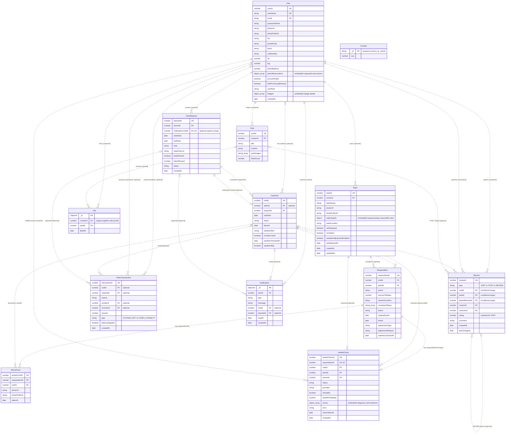

# Database logical ER diagram

Based on the Mongoose schemas in `server/models`, inspected on 4 November 2026. This describes the current code-defined structure; a running database was not inspected.

## Reading the diagram

- `||` = exactly one, `o|` = zero or one, `o{` = zero or many.
- `PK` marks MongoDB's physical `_id`. `UK` marks a unique application identifier or unique field. `FK` marks a logical reference, not a MongoDB foreign-key constraint.
- Every collection except `Counter` has an ObjectId `_id` (omitted below except where it is the only identifier). `Counter._id` is a string. Mongoose's version field is omitted.
- Numeric application identifiers use unique sparse indexes and counters. They are not the physical primary keys, and schemas allow them to be absent during creation.
- Optional references are labelled `optional`. Relationships express intended links; MongoDB does not enforce that referenced documents exist.

## Embedded structures

These are stored inside their parent document, not as separate collections.

| Parent field | Embedded fields |
| --- | --- |
| `User.tokenReservations[]` | `requestId` (logical reference to `CareRequest.requestId`), `amount`; Mongoose also generates a subdocument `_id` |
| `User.badges[]` | `id`, `name`, `description`, `icon`, `unlockedAt`; Mongoose also generates a subdocument `_id` |
| `Plant.wateringInfo` | `frequencyDays`, `amountMl`, `notes`; no subdocument `_id` |
| `HealthCheck.issues[]` | `name`, `probability`, `description`, `cause`, `commonNames[]`, `treatment.prevention[]`, `treatment.biological[]`, `treatment.chemical[]`; no subdocument `_id` |

## Important constraints and interpretation

- `RequestItem` links a plant to a particular visit. The request-to-plant relationship runs through `CareRequest → CareVisit → RequestItem → Plant`; there is no direct `requestId` on `RequestItem`.
- `Like` resolves the many-to-many relationship between users and posts. `(creatorId, postId)` is a unique compound index, while `_id` remains the physical primary key.
- `Review` stores visit feedback, post comments, and replies. Validation requires exactly one of `visitId`, `postId`, or `parentReviewId`, matching `type`. `(creatorId, visitId)` is unique only when `visitId` is numeric. Visit reviews require a rating from 1 to 5.
- `HealthCheck.requestItemId` is unique, so an item has at most one health check. `PhotoProof.requestItemId` is not unique: the schema permits multiple proofs per item.
- `CareRequest.makeupForVisitId` has a unique sparse index: a missed or expired visit can be referenced by at most one make-up request.
- A visit can have multiple token transactions overall, but a partial unique index allows at most one transaction of type `CARE` per `visitId`. System gifts have no sender; penalties have no receiver, as validated in the transaction creation code.
- `TokenTransaction.visitId` declares `ref: "Visit"`, although the actual model is `CareVisit`. The diagram shows the intended logical link. Numeric references target application IDs; Mongoose `ref` does not by itself enforce these links or make default `_id` population work for them.
- `Counter` is infrastructure for generating numeric identifiers. It has no document-level foreign-key relationship to the other collections.
- Explicit collection names are `User`, `Plant`, `CareRequest`, `CareVisit`, `RequestItem`, `PhotoProof`, `HealthCheck`, `Notification`, and `Counter`. `Post`, `Like`, `Review`, and `TokenTransaction` use Mongoose's default collection naming.

## Schema sources

All 13 models: [User](../server/models/userModel.js), [Plant](../server/models/plantModel.js), [CareRequest](../server/models/careRequestModel.js), [CareVisit](../server/models/careVisitModel.js), [RequestItem](../server/models/requestItemModel.js), [PhotoProof](../server/models/photoProofModel.js), [HealthCheck](../server/models/healthCheckModel.js), [Post](../server/models/postModel.js), [Like](../server/models/likeModel.js), [Review](../server/models/reviewModel.js), [TokenTransaction](../server/models/tokenModel.js), [Notification](../server/models/notificationModel.js), [Counter](../server/models/counterModel.js).
